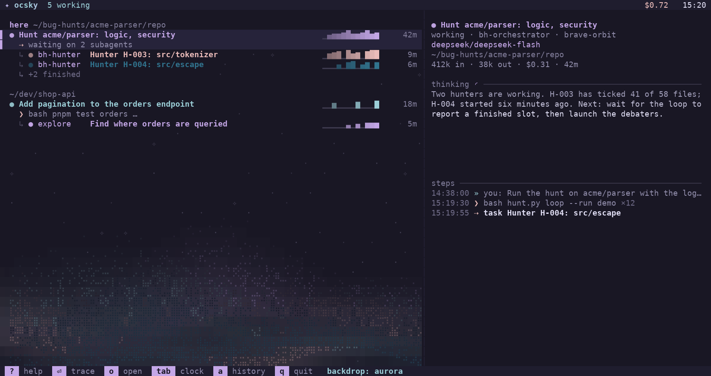
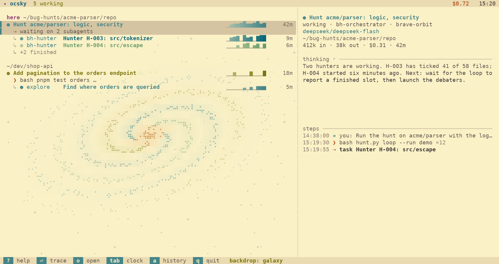
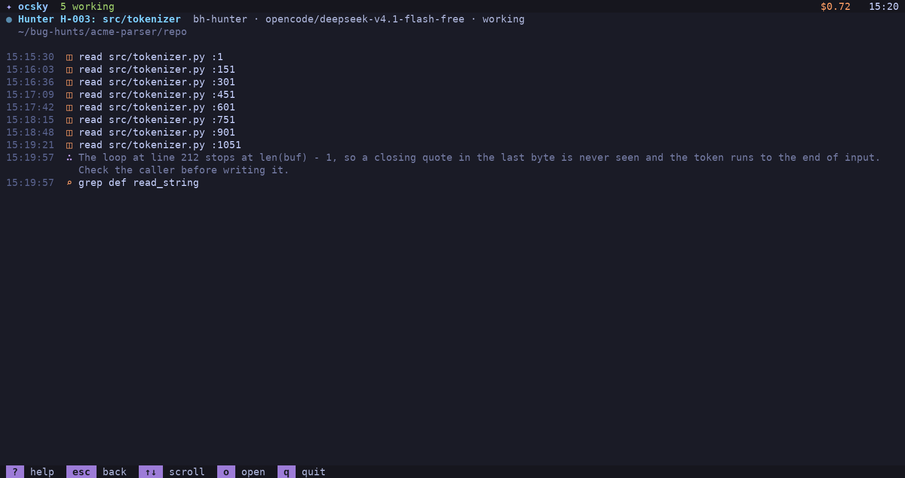

# ocsky

A live, animated terminal view of your [opencode](https://opencode.ai) agents: which sessions are working, waiting or finished, and what each one is doing right now.


## Install

```bash
uv tool install git+https://github.com/iDiagoValeta/ocsky
# or
pipx install git+https://github.com/iDiagoValeta/ocsky

ocsky          # or ocsky --demo, on a generated demo database
```

Python 3.9 or later and a terminal with 24-bit or 256 colours. No Python dependencies.

## What you see

- Sessions grouped by directory, subagents under their parent, and what each agent is doing and thinking right now.
- Three views: the live sky, a 24 hour clock with one orbit per model, and the trace of one session.
- Quiet backdrops behind the list (stars, a spiral galaxy, an aurora) and palettes from Catppuccin, Dracula, Gruvbox, Nord, Rosé Pine, Solarized and Tokyo Night.

| | |
|---|---|
|  |  |
|  |  |

Press `?` for the keys, `n` for the next backdrop and `p` for the palettes. Every key and option is in [docs/usage.md](docs/usage.md).

## Privacy

ocsky opens opencode's database read-only, queries only the session tables and has no network code. Nothing leaves your machine. Titles, prompts and reasoning from your own sessions show on screen, so mind what you share in a screenshot.

## Contributing

See [CONTRIBUTING.md](CONTRIBUTING.md). Apache-2.0, see [LICENSE](LICENSE).
