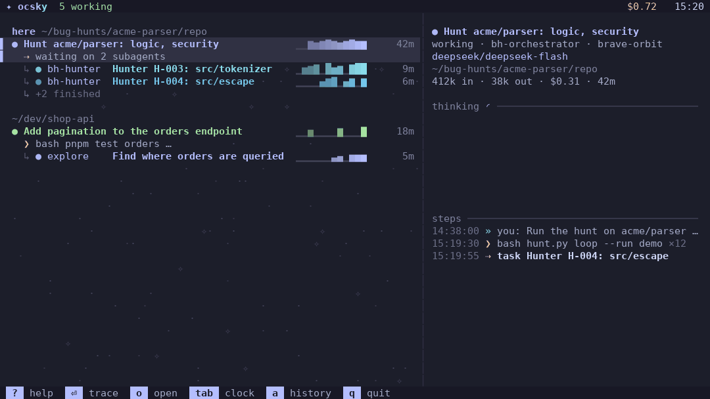
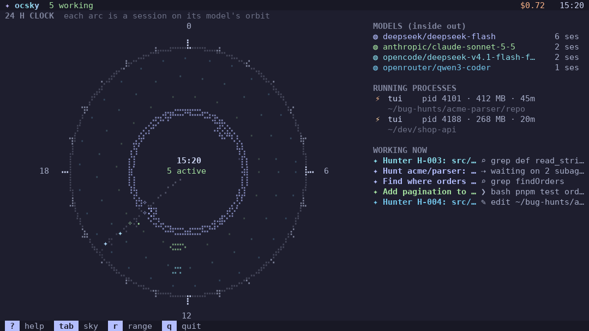

# ocsky

A live, animated terminal view of your [opencode](https://opencode.ai) agents: which sessions are working, waiting or finished, and what each one is doing right now.



## Install

```bash
uv tool install git+https://github.com/iDiagoValeta/ocsky
# or
pipx install git+https://github.com/iDiagoValeta/ocsky

ocsky
```

No opencode yet? `ocsky --demo` runs on a generated demo database.

Requirements: Python 3.9 or later and a terminal with 24-bit or 256 colours. There are no Python dependencies.

## What you see

- Sessions grouped by directory, with the directory you started ocsky in first and marked `here`.
- Subagents drawn under the session that spawned them. Finished ones fold into `+N finished`.
- What each agent is doing right now (the tool and its target) and its latest reasoning.
- Three views: the sky (the live list with a detail pane), a 24 hour clock with one arc per session on its model's orbit, and the trace of one session.
- Only the non-zero counts in the header: `N working`, `N waiting`, or `all quiet`.



## Keys

| Key | Action |
|---|---|
| `↑` `↓` or `j` `k` | Select a session |
| `PgUp` `PgDn` | Jump ten rows |
| `enter`, `l` or `→` | Open the trace of the selected session |
| `esc`, `h` or `←` | Go back |
| `tab` or `c` | Switch between the sky and the 24 hour clock |
| `space` | Fold or unfold finished subagents |
| `a` | Show or hide finished sessions |
| `r` | Next time range: 1h, 6h, 24h, 7d |
| `o` | Open the session in opencode |
| `y` / `Y` | Copy the session id / the session directory |
| `L` | Next language |
| `t` | Light or dark palette |
| `?` | Help |
| `q` or `ctrl-c` | Quit |

The copy keys use the terminal's OSC 52 escape sequence, so the terminal must allow clipboard writes.

## Options

| Option | Meaning |
|---|---|
| `--range {1h,6h,24h,7d}` | Time window of sessions to show (default `24h`) |
| `--all` | Start with the history visible |
| `--view {sky,clock,trace}` | View to start in |
| `--light` | Light palette (Catppuccin Latte) |
| `--db PATH` | opencode database file |
| `--colors {truecolor,256}` | 24-bit colours or the 256-colour palette (default: by terminal) |
| `--once COLSxROWS` | Print one frame of that size and exit |
| `--lang {en,es}` | Interface language |
| `--demo` | Run on a generated demo database |
| `--version` | Print the version and exit |

The database defaults to `$XDG_DATA_HOME/opencode/opencode.db`, or `~/.local/share/opencode/opencode.db` when the variable is unset. On Windows, where opencode's location is not confirmed, ocsky tries `XDG_DATA_HOME`, `%LOCALAPPDATA%` and `%APPDATA%` in that order and takes the first that exists; use `--db` if it guesses wrong.

## Language

English by default. Use `--lang es` or the `L` key for Spanish. The choice, and the palette chosen with `t`, are remembered in `~/.config/ocsky/config.json` (`$XDG_CONFIG_HOME/ocsky/config.json` when set, `%APPDATA%\ocsky\config.json` on Windows).

## Platforms

| Platform | Status |
|---|---|
| Linux | Supported. Running opencode processes are read from `/proc`. |
| macOS | Supported. Processes are read with `ps` and `lsof`. |
| Windows | Experimental. There is no process detection, so the waiting state is not detected. Not yet verified on a real Windows machine. |

CI runs the test suite and the install smoke test on Linux, macOS and Windows.

## Privacy

- ocsky opens opencode's database read-only (SQLite `mode=ro`), so SQLite itself refuses every write.
- It queries only `session_v2` and `session_message`. It never opens the account or credential tables.
- It has no network code: the source imports no socket or HTTP module.
- Nothing leaves the machine. The only commands it runs are `ps` and `lsof` to list opencode processes (macOS), and `opencode --session <id>` when you press `o`.

Sessions show titles, prompts, commands and reasoning from your own database on your own screen. Keep that in mind when you share a screenshot.

## How it is built

A hexagonal layout: the core knows nothing about SQLite, the terminal or the operating system.

```
src/ocsky/
  main.py                 composition root: the only module that builds adapters
  core/                   model, states, tree, observatory (pure, no IO)
    ports/                one Protocol per thing the core needs from outside
  adapters/
    driven/               SQLite, processes, clock, launcher, clipboard, preferences
    driving/              command line and the terminal interface (app, views, i18n)
```

`tests/test_architecture.py` enforces the import rules with `ast`: the core imports only a small allowlist of standard modules, the two adapter families never import each other, and only `main.py` imports both.

## Development

```bash
git clone https://github.com/iDiagoValeta/ocsky
cd ocsky
python3 -m unittest discover -s tests
ruff check src tests tools
python3 tools/render_demo.py   # regenerates docs/demo.gif, docs/sky.png, docs/clock.png (needs Pillow)
```

Run from the checkout with `PYTHONPATH=src python3 -m ocsky --demo`. See [CONTRIBUTING.md](CONTRIBUTING.md) for the workflow.

## License

Apache-2.0. See [LICENSE](LICENSE).
